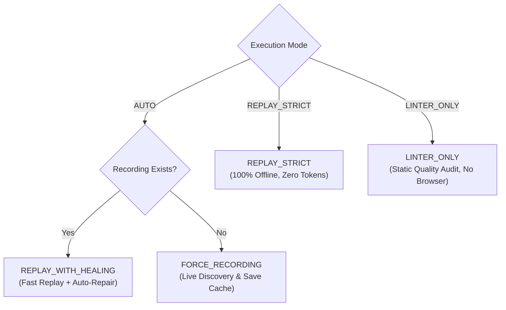
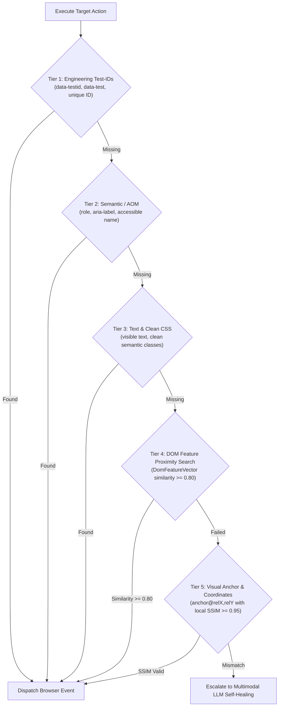

Neodymium AI rethinks automated testing by separating **human test intent** from **machine execution artifacts**. This architecture eliminates the twin bottlenecks of traditional testing: brittle handwritten DOM selectors and ongoing Page Object Model maintenance.

---

## 1. The Playbook Paradigm

In conventional test automation (Selenium, Playwright, Selenide), engineers write procedural code that couples test intent with ephemeral DOM selectors (`driver.findElement(By.cssSelector("div.app > form > button.btn-v2"))`). When the UI refactors, the automation code breaks.

With Neodymium AI:
* **Human specs are the single source of truth**: You author plain-language YAML playbooks describing the user journey.
* **Separation of intent and mechanics**: The AI engine translates high-level intents (*"Click the Place Order button"*) into robust, concrete browser actions.
* **Deterministic preservation**: Instead of asking the AI to guess on every run, the resulting actions are compiled once and stored in local, version-controlled files.

---

## 2. The Companion Recording Cache (`.recording.json`)

When a playbook runs for the first time, Neodymium AI generates a companion JSON file matching the playbook's name:

```text
src/test/resources/playbooks/
├── checkout-flow.yaml            # Human-authored test specification
└── checkout-flow.recording.json  # Auto-generated execution cache
```

The companion recording stores:
* **Normalized Actions**: Low-level browser operations (`NAVIGATE`, `CLICK`, `TYPE`, `SELECT`, `ASSERT`).
* **Resilient Locators**: Ranked candidate selectors chosen for stability (IDs, test attributes, semantic roles).
* **DOM Feature Vectors**: Snapshots of tag names, parent hierarchies, and sibling positions for similarity recovery.
* **Visual Baseline Hashes**: $128 \times 128$ perceptual luminance and color SSIM matrices for visual verification steps.
* **Execution Timing**: Millisecond action durations and delays for paced replay.

---

## 3. Execution Modes

Neodymium AI provides six execution modes to balance speed, cost, and authoring flexibility:



| Execution Mode | Description | LLM Calls | Best For |
| :--- | :--- | :--- | :--- |
| **`AUTO`** | **Default mode.** Inspects the filesystem. If a recording exists, runs in `REPLAY_WITH_HEALING`. If missing, compiles live in `FORCE_RECORDING`. | Only if missing or healed | Everyday development and routine test execution. |
| **`REPLAY_WITH_HEALING`** | Replays recorded actions at native browser speed. If a selector fails, triggers localized LLM healing, updates `.recording.json`, and resumes. | 0 (unless healed) | Standard regression runs where UI changes may occur. |
| **`REPLAY_STRICT`** | Strict deterministic offline execution. Any selector failure or visual mismatch fails immediately without calling an LLM. | **0 tokens guaranteed** | CI/CD merge validation pipelines and strict regression suites. |
| **`FORCE_RECORDING`** | Bypasses existing recordings, executes all steps live via the LLM, and regenerates the entire companion `.recording.json` file. | Yes (every step) | Creating new tests or intentionally re-baselining existing flows. |
| **`LLM_ONLY`** | Executes live with LLM reasoning on every turn without reading or writing companion recording files. | Yes (every turn) | Exploratory testing or prototyping interactive prompts. |
| **`LINTER_ONLY`** | Audits the YAML playbook upfront against 9 static quality rules, generates linting reports, and finishes without launching a browser. | 1 batch call | Fast PR linting and syntax verification. |

Configure the mode globally in `config/ai.properties` or on specific tests using the `@AiMode` annotation:

```java
@AiMode(ExecutionMode.REPLAY_STRICT)
@AiPlaybook("/playbooks/checkout-flow.yaml")
public void testStrictRegression(final AiSession session) { ... }
```

---

## 4. The 5-Tier Cascading Locator Engine

When executing recorded actions or resolving elements during replay, Neodymium AI routes target resolution through a **5-Tier Cascading Locator Engine**:



1. **Tier 1: Engineering Test-IDs**: Direct lookup of explicit QA attributes (`data-testid`, `data-test`, `data-qa`, unique non-volatile IDs).
2. **Tier 2: Semantic / AOM (Accessibility Object Model)**: Matches computed accessible names, ARIA roles, input placeholders, and label associations.
3. **Tier 3: Visible Text & Standard CSS**: Matches visible button text, link texts, and standard semantic CSS selectors.
4. **Tier 4: DOM Feature Proximity Search (`DomFeatureVector`)**:
   If direct selectors fail due to code refactorings or CSS-in-JS class generation, the engine evaluates local candidate similarity across structural properties:
   * Tag compatibility (35%)
   * Attribute Jaccard similarity (30%)
   * Text Levenshtein string distance (25%)
   * CSS class overlap (10%)
   Matches scoring $\ge 0.80$ resolve automatically in $< 1\text{ ms}$ without calling external LLMs.
5. **Tier 5: Visual Anchor & Coordinates**: Resolves elements via container-relative coordinates with local $64 \times 64$ luminance SSIM gating.
6. **LLM Self-Healing Escalation**: Only if all 5 tiers fail does the engine escalate to live LLM self-healing.

---

## 5. Monotonic Context Escalation Ladder

When Neodymium AI needs to query the LLM (during creation or self-healing), sending the entire raw HTML page would exhaust token budgets and slow down execution. Instead, the engine employs an **8-tier context escalation ladder** across two strictly monotonic tracks:

$$\textbf{Track A (DOM Track): } \text{HINT} \longrightarrow \mathbf{MINIMAL} \longrightarrow \mathbf{LEAN} \longrightarrow \mathbf{STANDARD} \longrightarrow \mathbf{RICH} \longrightarrow \mathbf{VISUAL\_RICH}$$
$$\textbf{Track B (Visual Track): } \mathbf{VISUAL} \longrightarrow \mathbf{VISUAL\_LEAN} \longrightarrow \mathbf{VISUAL\_RICH}$$

| Context Level | Mode | What the LLM Sees | Typical Use Case |
| :--- | :--- | :--- | :--- |
| **`HINT`** | Text | **0 DOM Nodes.** Only URL and page title (~20 characters). | Explicit selector hint provided via `(hint: #id)`. |
| **`MINIMAL`** | Text | **Form controls only.** Inputs, selects, and submit buttons (~300–800 tokens). | Form filling, authentication, and simple data entry. |
| **`LEAN`** | Text | **Interactive elements + headings.** Buttons, links, inputs, and section headings. Massive paragraphs are filtered out. | **Default initial level.** Navigation, clicking cards, interacting with menus. |
| **`STANDARD`** | Text | **`LEAN` + full static copy.** Includes `<p>`, `<span>`, `<div>`, order totals, and table contents. | Text assertions, paragraph validations, content checks. |
| **`RICH`** | Text | **`STANDARD` + full metadata.** All `data-*` attributes, ARIA descriptions, and 5-level parent ancestry. | Complex disambiguation, SKU verification, custom table grids. |
| **`VISUAL`** | Visual | **Viewport screenshot + 0 DOM nodes.** | Pixel-exact visual verification without DOM interactions (`(visual)`). |
| **`VISUAL_LEAN`** | Visual | **Full-page screenshot + `LEAN` DOM.** | Visual element interactions and Set-of-Marks grounding. |
| **`VISUAL_RICH`** | Visual | **Full-page screenshot + `RICH` DOM.** | Maximum multimodal context; used for layout wireframe tests (`(layout)`). |

:::note[Monotonic Escalation Guarantee]
Escalation is strictly monotonic: when escalating from `STANDARD` to `RICH` or `RICH` to `VISUAL_RICH`, the model never loses previously extracted DOM information. The engine ensures full context preservation across every attempt.
:::
