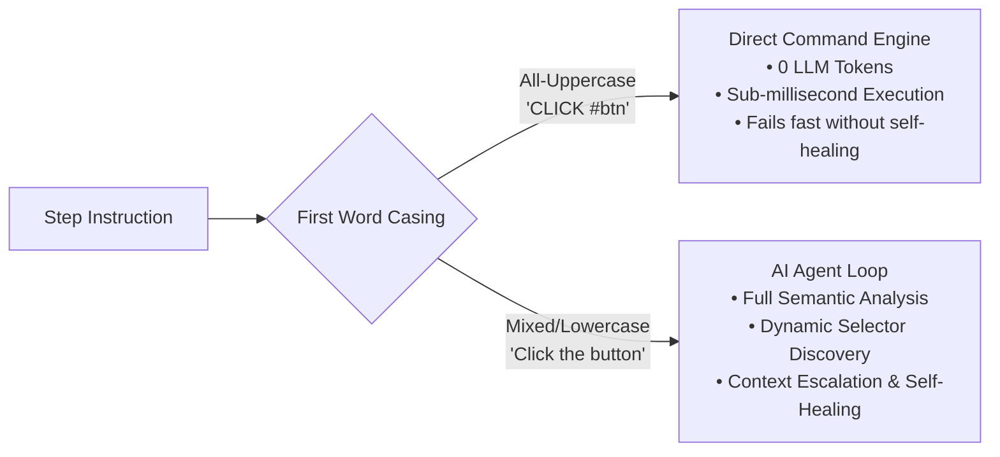

While natural language instructions are ideal for discovering dynamic elements and complex workflows, many test steps are purely deterministic (such as opening a URL, waiting for an animation, or clicking a known ID).

Neodymium AI introduces **Direct Commands**, allowing you to bypass LLM reasoning entirely. Direct commands execute 100% locally on the browser, offering extreme execution speed, zero token usage, and total determinism.

---

## 1. Routing & Casing Rules

Neodymium AI determines how to execute a step based on the **case-sensitivity of the first word**:



* **Direct Command Route (All-Uppercase First Word)**:
  - **Rule**: The first word contains only uppercase letters, numbers, and underscores (e.g., `OPEN`, `CLICK`, `TYPE`, `WAIT`).
  - **Behavior**: Bypasses the LLM, resolves the instruction locally using action plugins, and executes immediately.
  - **Example**: `CLICK #submit-btn`, `OPEN https://example.com`, `WAIT 2s`

* **Natural Language Route (Mixed/Lowercase First Word)**:
  - **Rule**: The first word contains lowercase characters.
  - **Behavior**: Dispatched to the AI agent loop with context escalation and semantic self-healing.
  - **Example**: `Click the submit button`, `Open https://example.com`, `Wait for spinner to disappear`

---

## 2. Direct Command Catalog

Neodymium AI provides 14 built-in direct commands covering all standard browser automation operations:

| Command | Syntax & Description | Example |
| :--- | :--- | :--- |
| **`OPEN`** / **`NAVIGATE`** | `OPEN <url>`<br />Opens a URL. Supports basic HTTP authentication using `with basic auth user "<user>" password "<pass>"`. | `OPEN https://example.com`<br />`NAVIGATE https://example.com with basic auth user "admin" password "secret"` |
| **`CLICK`** | `CLICK <selector>`<br />Clicks the element matching the selector. | `CLICK #login-button`<br />`CLICK xpath=//button[@type='submit']` |
| **`TYPE`** | `TYPE "<value>" into <selector>`<br />Enters text into the target element (clearing prior text). | `TYPE "user@example.com" into #email`<br />`TYPE secret123 into css=#password` |
| **`SELECT`** | `SELECT "<value>" in <selector>`<br />Selects an option from a `<select>` dropdown by visible text or value. | `SELECT "United States" in #country`<br />`SELECT "Blue" in #color-picker` |
| **`CLEAR`** | `CLEAR <selector>`<br />Clears text in an input/textarea, or unchecks a checkbox. | `CLEAR #search-input` |
| **`HOVER`** | `HOVER <selector>`<br />Moves the mouse cursor over the target element to trigger hover menus. | `HOVER #navigation-menu` |
| **`WAIT`** | `WAIT <duration>`<br />Pauses execution for a specified duration in milliseconds or seconds (`s`). | `WAIT 500`<br />`WAIT 2.5s` |
| **`SCROLL`** | `SCROLL <selector>` / `SCROLL <direction>`<br />Scrolls the browser to an element, or in a direction (`up` / `down`). | `SCROLL #footer`<br />`SCROLL down` |
| **`KEYPRESS`** | `KEYPRESS <key1>, <key2>, ...`<br />Presses a key or key combination (e.g. `Enter`, `Tab`, `Escape`, `Ctrl+A`). | `KEYPRESS Enter`<br />`KEYPRESS Tab, Tab, Enter` |
| **`BACK`** | `BACK`<br />Navigates back one step in browser history. | `BACK` |
| **`FORWARD`** | `FORWARD`<br />Navigates forward one step in browser history. | `FORWARD` |
| **`REFRESH`** | `REFRESH`<br />Reloads the current active browser page. | `REFRESH` |
| **`CLEAR_COOKIES`** | `CLEAR_COOKIES`<br />Deletes all cookies for the current domain. | `CLEAR_COOKIES` |
| **`java:<method>`** | `java: <methodName>(<args>)`<br />Reflectively executes a Java method on the active test class or utilities. | `java: assertOrderTotal("${orderId}")` |

---

## 3. Selector Syntax & Auto-Wrapping

Selectors in direct commands support standard CSS and XPath:

* **Default to CSS**: When unadorned, selectors are treated as CSS:
  ```text
  CLICK #submit-order
  CLICK button.btn-primary
  ```
* **Explicit Prefixes**: Prefix with `css=` or `xpath=` case-insensitively:
  ```text
  CLICK css=button[data-testid='checkout']
  CLICK xpath=//button[contains(text(),'Pay')]
  ```
* **Auto-Wrapping XPath**: XPath expressions not beginning with `/` or `(` are automatically normalized and wrapped safely:
  ```text
  CLICK xpath=a[text()='Login']   # Automatically normalized to (a[text()='Login'])
  ```

---

## 4. Best Practices: Writing Hybrid Playbooks

The most effective testing strategy combines **Direct Commands for mechanical steps** with **Natural Language for user intent and verification**:

```yaml
name: Hybrid Shopping Cart Checkout
steps: |
  # Fast, deterministic setup (0 tokens)
  OPEN https://example.com/shop
  CLEAR_COOKIES
  
  # Natural language element exploration (AI-powered discovery)
  Locate the first item card and click its 'Add to Cart' button
  
  # Deterministic navigation
  CLICK #cart-icon
  
  # Complex intent & verification
  Verify the mini cart contains 1 item
  Verify the subtotal is displayed
  
  # Direct submission
  CLICK #checkout-btn
```

:::tip[Performance Advantage]
By using direct commands for predictable steps (like opening URLs, clearing cookies, and known navigation anchors), you reduce total test execution time by up to 80% while saving LLM API costs during initial creation runs.
:::
