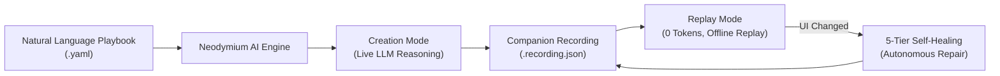

**Neodymium AI** is an intelligent, domain-neutral test automation engine built on top of Java, Selenide, and Selenium WebDriver. It bridges the divide between human test specifications and executable browser automation by compiling natural language playbooks into robust, millisecond-fast offline test runs.

Unlike traditional AI automation tools that query expensive cloud Large Language Models (LLMs) on every single step or generate intermediate code that must be maintained manually, Neodymium AI introduces the [**Playbook Paradigm**](/neodymium-ai/core-concepts#1-the-playbook-paradigm):

1. **Human Specs as the Single Source of Truth**: Scenarios are written in plain, human-readable natural language without writing Page Object Models, selector locators, or glue code.
2. **Intent Compilation**: During the initial execution ([**Creation Mode**](/neodymium-ai/core-concepts#3-execution-modes)), Neodymium AI parses instructions, explores the live application DOM, resolves resilient element locators, and records a companion JSON file ([`.recording.json`](/neodymium-ai/core-concepts#2-the-companion-recording-cache-recordingjson)).
3. **Zero-Token Offline Replay**: On all subsequent runs ([**Replay Mode**](/neodymium-ai/core-concepts#3-execution-modes)), tests replay 100% offline at native browser speed with zero LLM API costs.
4. **Autonomous Self-Healing**: If UI refactorings or CSS framework updates invalidate recorded selectors, Neodymium AI automatically escalates through a [5-tier locator engine](/neodymium-ai/core-concepts#4-the-5-tier-cascading-locator-engine), heals the broken action in the live browser, and updates the local recording file.

---

## Core Capabilities

| Capability | Description |
| :--- | :--- |
| [**Natural Language Playbooks**](/neodymium-ai/playbook-authoring) | Write clear, business-readable test steps in YAML using multiline text, sequence lists, folded batch assertions, and compound milestones. |
| [**Direct Commands**](/neodymium-ai/direct-commands) | Execute deterministic commands (`CLICK`, `TYPE`, `OPEN`, `WAIT`) with capitalized verbs to bypass LLM inference completely for instant execution. |
| [**Visual & Layout Testing**](/neodymium-ai/visual-testing) | Go beyond DOM locators with pixel-exact visual verification (`(visual)`), content-agnostic color wireframe layout testing (`(layout)`), and Set-of-Marks visual markers (`(marker)`). |
| [**Quality Governance**](/neodymium-ai/quality-and-stability) | Catch ambiguous instructions before execution with the Upfront Pre-Flight Linter (`@AiLinter`) and eliminate runtime friction with the Empirical Post-Flight Linter. |
| [**Protocol Introspection**](/neodymium-ai/quality-and-stability#5-protocol-introspection-network--console-error-detection) | Automatically monitor browser network failures (HTTP 4xx/5xx) and unhandled JavaScript console exceptions to prevent agent locator thrashing on backend failures. |
| [**Neodymium AI Manager**](/neodymium-ai/manager) | Manage your test suites, edit playbooks visually, chat with the AI test assistant, and track execution trends with customizable telemetry widgets. |

---

## Documentation Guide

Explore the chapters below to get started with Neodymium AI:

:::tip[Quickstart Recommendation]
If you are new to Neodymium AI, start with the [Quick Start](/neodymium-ai/quick-start) guide to write and execute your first natural language test playbook in less than 5 minutes.
:::
