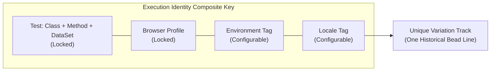

Neodymium AI offers two interactive operational experiences:
1. **Standalone Interactive Console**: Built directly into `neodymium-core` with zero external dependencies. It automatically launches a lightweight embedded browser console whenever a JUnit test is executed with `-Dneodymium.ai.interactive=true`.
2. **Neodymium AI Manager (Web Hub)**: A dedicated web application for authoring playbooks visually, collaborating with an AI chat assistant, queueing test batches, monitoring test runs live, and curating multi-dimensional telemetry dashboards.

---

## 1. Standalone Interactive Console (No Manager Required)

You do not need to install or run the full AI Manager to monitor and interact with test executions. Neodymium AI includes a built-in, lightweight interactive console engine.

### Launching Standalone Interactive Mode

Enable interactive mode using any standard configuration mechanism:

#### Via Maven Command Line
```bash
mvn test -Dtest=SampleSearchTest -Dneodymium.ai.interactive=true
```

#### Via Property File
Add to `config/dev-neodymium.properties` (or `config/ai.properties`):

```properties
neodymium.ai.interactive=true
```

#### Via Environment Variable
```bash
export NEODYMIUM_AI_INTERACTIVE=true
```

### How the Standalone Console Operates

When `neodymium.ai.interactive=true` is enabled and the AI Manager is not running:

1. **Embedded Java Server**: `NeodymiumAiRunner` spins up a minimal, internal Java HTTP server binding to port `18090` (or the next available port). No Spring Boot, Node.js, or external daemon is required.
2. **Automatic Browser Launch**: The test runner automatically launches your default browser or opens a dedicated app window to `http://localhost:18090`.
3. **Live SSE Streaming**: State snapshots, step descriptions, and live viewport screenshots are streamed in real time via Server-Sent Events (`/api/console/events`).
4. **Interactive Failure Interception**: When a step encounters a locator failure or timeout, the execution pauses immediately with a unique `pauseId`, offering interactive controls directly in the browser:
   * **AI Heal**: Triggers an on-demand multimodal LLM healing cycle to resolve the broken selector against the live DOM and update the recording.
   * **Retry / Run**: Re-attempts the current step immediately.
   * **Auto-Run**: Resumes continuous test execution without pausing on subsequent steps.
   * **Skip**: Bypasses the failing step and moves to the next playbook instruction.
   * **Abort**: Terminates the test run immediately.
5. **Automatic Teardown**: As soon as the JUnit test lifecycle completes, the embedded HTTP server shuts down automatically.

---

## 2. Launching the Full AI Manager Hub

For team-wide visual editing, AI chat authoring, and cross-suite telemetry dashboards, launch the full AI Manager application:

```bash
# Launch via Maven
mvn spring-boot:run -pl aura-manager
```

Once initialized, navigate to `http://localhost:8080` in your web browser.

---

## 3. Live Reports During Runs (Connecting Console Runs to the Manager)

You do not need to trigger tests from the AI Manager web UI to inspect live test progress in the dashboard. Tests launched from your command line terminal or CI/CD runner can stream live reports directly into the running AI Manager.

### What is Needed for Console Runs to Stream Live

Ensure the AI Manager is running at `http://localhost:8080`, then pass the following parameters to your Maven CLI execution:

```bash
mvn test \
  -Dneodymium.managerActive=true \
  -Dneodymium.managerUrl=http://localhost:8080 \
  -Dneodymium.managerRunId="nightly-run-42"
```

Alternatively, define them in `config/dev-neodymium.properties` for your local workstation:

```properties
# config/dev-neodymium.properties
neodymium.managerActive=true
neodymium.managerUrl=http://localhost:8080
```

### Live Streaming Mechanics

1. **Active Run Registration**: As soon as the JUnit test begins, `NeodymiumAiRunner` detects `neodymium.managerActive=true` and registers the run with the AI Manager using `neodymium.managerRunId`.
2. **Real-Time Step & Screenshot Ingestion**: During execution, the test process pushes state updates, step transitions, and base64 viewport screenshots via HTTP POST to `/api/console/internal/pushState`.
3. **Live Dashboard Monitoring**:
   * Open `http://localhost:8080/runs` to see the active test run labeled with a dynamic **RUNNING** badge.
   * Drill into the Run Report while the test is still executing to view the live action timeline, step progress bars, and live screenshot feed without waiting for the suite to finish.
4. **Interactive Web Control (Optional)**: If you also add `-Dneodymium.ai.interactive=true`, the test runner routes interactive failure pauses directly into the AI Manager web UI, allowing you to trigger AI self-healing or skip steps right from the browser.

---

## 4. Tags & Dimensional Organization: The Special `Suite` and `Area` Tags

Metadata tags provide multi-dimensional categorization for test filtering, reporting, and dashboard grouping. Tags can be defined directly inside YAML playbooks or annotated on Java test classes:

```yaml
# Inside your YAML playbook:
name: Order Checkout Flow
tags:
  Suite: Regression
  Area: Checkout
  Environment: Staging
  Release: 2026.4
```

```java
// Or on your Java test class:
@Tag("Suite:Regression")
@Tag("Area:Checkout")
@NeodymiumAiTest
public class CheckoutTest { ... }
```

While any arbitrary key-value tag is supported for custom filtering, **`Suite`** and **`Area`** are first-class framework tags with special behavior across the AI Manager:

### The Special `Suite` Tag
* **Execution Batching**: `Suite` identifies the logical test collection (e.g. `Suite: Smoke`, `Suite: Regression`, `Suite: Nightly`, `Suite: Payment`).
* **Runs List Grouping**: The AI Manager groups runs under their declared `Suite` identifier in the Runs history table and test execution queue.
* **Scope Filtering**: Dashboard pages and individual widgets can filter contributing runs by `Suite`, allowing teams to isolate metrics specifically for regression or smoke suites.
* **Group Dashboard Dimension**: Serves as a standard grouping dimension to generate partitioned sub-dashboards automatically.

### The Special `Area` Tag
* **Functional Domain Hierarchy**: `Area` defines the business domain or application feature under test (e.g. `Area: Checkout`, `Area: Search`, `Area: Catalog`, `Area: Account`).
* **Run Report Accordions**: The AI Manager automatically groups test executions on the Run Report page into collapsible **Area Folders** (e.g. `📁 Area: Checkout`, `📁 Area: Search`). Tests without an explicit area tag are cleanly grouped under `📁 Area: Default`.
* **Area Breakdown Visualizations**: Pre-configured widget templates display status distribution across functional areas to instantly spot which business domain has regressions.
* **Domain Partitioning**: Group Dashboards can be partitioned by `Area`, generating dedicated dashboard tabs for each functional feature team.

---

## 5. The Concept of Execution Identity

When tests execute repeatedly across batch runs over time, the dashboard must determine: **"Which test result in Run #2 corresponds to which test from Run #1?"**

This correlation is governed by the **Execution Identity**—the composite coordinate key that uniquely identifies a test variation across history.

### Base (Mandatory) Coordinates
The base identity is permanently locked to:
* **Test**: Class Name + Method Name + DataSet ID (e.g. `CheckoutTest.testPurchase[us_credit]`).
* **Browser**: Browser profile configuration (e.g. `Chrome_1500x1000_headless`).

Because a test running on Chrome represents a different execution track than the same test running on Firefox, the browser is always part of the base identity.

### Configurable Identity Dimensions
Teams can customize the Execution Identity at the dashboard or widget level by toggling additional metadata dimensions:
* `Environment` (e.g. `Staging` vs. `Production`)
* `Locale` (e.g. `en_US` vs. `de_DE`)
* Custom tags (e.g. `Device`, `Branch`)



### Impact on Trend Analysis & String of Pearls
The choice of Execution Identity directly determines how history is visualized:

* **When `Environment` IS part of the Identity:**
  * `CheckoutTest (Chrome, Staging)` and `CheckoutTest (Chrome, Prod)` are tracked as **two distinct rows / bead lines** in the String of Pearls.
  * You can evaluate staging stability independently of production health.
* **When `Environment` is NOT part of the Identity:**
  * Both executions are treated as the same test track. The most recent run updates the single variation status.

:::important[Widget Combination Equivalence Rule]
To guarantee statistical integrity, two dashboard widgets can only be merged into a single container card if they share the **exact same Execution Identity dimensions** and evaluate the same contributing run scope.
:::

---

## 6. Comprehensive Dashboard Management

Neodymium AI Manager features a modular, drag-and-drop dashboard engine for tracking test suite health, execution stability, and token costs.

### Default Pre-Configured Dashboards

Out of the box, the AI Manager provides three pre-configured dashboards tailored for different operational perspectives:

#### 1. General Overview Dashboard
Provides a holistic high-level snapshot of recent test executions, key performance indicators (KPIs), overall pass rate, token cost trajectory, and recent run history:


#### 2. Test Health Dashboard
Dedicated to flakiness tracking, healing frequency, step retry rates, and failure distributions across your test suites:


#### 3. Costs & Token Usage Dashboard
Detailed breakdown of LLM resource expenditure, tracking prompt tokens, cached input tokens, completion tokens, and dollar-equivalent costs per model:


---

### A. Dashboard Page Management
* **Custom Pages**: Create tailored dashboard views for specific teams, sprints, or release cycles.
* **Initial Landing Dashboard**: Selecting a custom landing dashboard or reordering dashboard pages is not currently supported; the first dashboard listed in the sidebar opens automatically upon startup.
* **Page Organization**: Rename, clone existing setups, or delete obsolete dashboards.
* **Standard vs. Group Dashboards**:
  * **Standard Dashboards**: Curated collections of widgets with fixed filters.
  * **Group Dashboards**: Automatically partitions a dashboard by a selected dimension (e.g. by `Browser`, `Environment`, `Suite`, or `Area`). The Manager dynamically generates child sub-dashboard tabs for each discovered dimension value, applying inherited filters down the tree.


#### Configuring Group Dashboards
When creating or converting to a Group Dashboard, specify the grouping dimension to automatically partition the test suite into overview cards and nested sub-dashboards:


Once configured, child dashboards appear neatly organized in the sidebar navigation tree:


The parent group page renders high-level summary cards with embedded status distribution charts for each group value:


---

### B. Widget Canvas, Layout & Configuration
* **Flexible Sizing**: Place widgets in a responsive grid using 25% (quarter), 50% (half), 75% (three-quarter), or 100% (full-width) cards.
* **Drag-and-Drop Reordering**: Arrange widgets freely across the canvas.

#### Widget Grouping (Composite Containers)
You can combine two or more compatible widgets into a single **Composite Container Card** (`presentation: CONTAINER`) by dragging one widget directly onto another:
* **Drop Overlay**: Hovering a dragged widget over a target card displays *"Combine into Container"*.
* **Container Header**: Displays the container title, `layers` icon, child widget count (e.g. `2 Linked Widgets`), target time scope, Execution Identity badge (`fingerprint`), and action buttons to **Rename**, view **Contributing Executions**, **Separate** back into standalone widgets, or **Delete**.
* **Adaptive Child Layout**: Compact widgets (such as Pie, Donut, and Ratio charts) sit side-by-side, while wide visualizations (such as String of Pearls or Known Variations) automatically stretch across the full width of the container.
* **Internal Child Reordering**: Each child section inside the container features its own child drag handle, allowing you to reorder charts *within* the container card without dissolving it.
* **Container Constraints**: Tabular `RUNS` list widgets require full row width (100%) and cannot be merged into containers.


#### Filtering in Widget Groups & Containers
Filtering operates across multiple coordinated tiers:
* **Static Run Scope Filters (Widget & Container Level)**:
  * By default, widgets evaluate runs scoped by global dashboard filters.
  * Any widget or container group can enable **"Custom Run Filters"** in the Widget Configurator to evaluate an independent dataset, completely unaffected by global dashboard filters.
  * Configurable criteria include: Run Limit (last 5, 10, 25, 50, or All runs), Date/Timestamp range (`From` / `To`), Browsers, Locales, Environments, Areas, and custom tags (`Suite`, `Release`, `Branch`).
  * When active, a **Filtered Strip** appears above the charts with categorical badges (e.g. `[Chrome] [Area: Checkout] [Staging]`).
* **Interactive In-Container Cross-Filtering (Client-Side)**:
  * Containers embed a unified dataset of all evaluated test variations.
  * Clicking any segment or slice in a child widget (e.g. the Failed slice in a Status Pie Chart or a specific Browser pill) triggers instant client-side cross-filtering across sibling charts without reloading the page.
  * An **Active Filter Strip** expands below the header (`Active Filter: [Status: FAILED ✕] [Clear all]`).
  * Sibling ratio bars or cost metrics adjust immediately to reflect the filtered slice, while unmatched rows or timeline beads dim or hide.
* **Filtered Contributing Executions Modal**:
  * Clicking the list icon on a container opens the executions modal scoped to the container's active filters, with real-time text searching and status toggles (`Passed`, `Fixed`, `Flaky`, `Failed`, `Ignored`).


#### Widget Configurator
Each widget can be customized with specific execution identity overrides, scope filters, and presentation options:


#### Presentation Forms
The configurator allows switching between multiple presentation formats, such as Pie, Donut, Ratio Bar, Beaded Timeline, or Tabular List:


---

### C. Widget Catalog
* **Status Distribution**: Pie, donut, and ratio bar charts breaking down test outcomes (`PASSED`, `HEALED`, `FAILED`, `RUNNING`).


* **String of Pearls**: Chronological beaded timelines displaying the status progression of individual test variations across recent batch runs or release cycles.


* **Known Variation Tracks**: Tracks recognized test execution variations across historical runs according to the configured Execution Identity:


* **Flakiness & Defect Tracking**: Identifies unstable test steps, frequently healed selectors, and expected bug tag (`(bug)`) trends:


* **Token Cost & Usage Trends**: Chronological bar and line graphs tracking cumulative prompt, completion, and cached token consumption over time to monitor cloud LLM costs.
* **List of Runs**: Full tabular history of recent test runs with execution IDs, status pills, durations, and direct links to reports.
* **Metric Summary Cards**: High-level KPI tiles for pass rate, total runs, active defects, and average runtime.

---

### D. Interactive Cross-Filtering & Drill-Down
* **Interactive Chart Slices**: Clicking any chart segment (e.g. the "Healed" slice of a donut chart) filters other widgets on the dashboard.
* **Contributing Executions Drawer**: Clicking any data point or trend node opens a slide-out modal displaying the exact list of contributing test runs, with one-click drill-down into detailed step execution logs and failure screenshots.

---

## 7. Visual Playbook Editor

The Visual Playbook Editor allows developers and QA teams to inspect, author, and refine YAML playbooks directly in the web browser without manual text editing:


### Key Editor Capabilities
* **Interactive Step Sequencing**:
  * View, reorder, add, or delete test steps with drag-and-drop handles.
  * Edit step instructions in plain natural language or specify direct deterministic commands (such as `click`, `type`, `navigate`, `scroll`).
* **Control Tag & Parameter Inspector**:
  * Configure step parameters and control tags through intuitive UI toggles:
    * `(visual)`: Enforces computer-vision-based layout or pixel comparison checks.
    * `(hint: ...)`: Supplies targeted selector hints to guide AI locator discovery.
    * `(optional)`: Allows non-critical steps to proceed gracefully on failure.
    * `(timeout: ...)`: Sets custom step execution deadlines.
  * Define and manage dataset parameters and variable interpolations (`${variable}`).
* **Recording Synchronization**:
  * Side-by-side inspection of the companion `.recording.json` file.
  * View concrete captured DOM locators, action histories, and visual baselines directly alongside the high-level playbook steps.
* **Direct Filesystem Persistence**:
  * Save updates immediately back to the local repository, ensuring version control (`git diff`) cleanly tracks all changes.

---

## 8. Interactive AI Chat Assistant

Collaborate with the built-in AI assistant to author and refine test scenarios:

* **Page Exploration**: Command the assistant to navigate to target pages, inspect elements, and suggest optimal test step sequences.
* **Natural Language Refinement**: Transform high-level requirements (*"Test user sign-up with invalid email"*) into concise, lint-free playbook steps.
* **Selector Recommendations**: Inspect live candidate locators and evaluate stability scores before committing to playbooks.

---

## 9. Test Selection & Execution Queue

The AI Manager provides an interactive execution hub for staging, configuring, and executing test suites without leaving the browser:


### Building the Execution Queue
* **Test Tree Exploration**:
  * Browse discovered test classes, YAML playbooks, and reusable step fragments (`.steps`) in a structured package hierarchy.
  * Inspect associated tags (`Suite`, `Area`, `Environment`) and dataset variations directly from the sidebar.
* **Granular Queue Composition**:
  * Add entire folders, single playbooks, or individual dataset rows to the staged queue with a single click.
  * Mix and match tests across different feature areas for custom ad-hoc or sanity runs.
* **Queue Configuration & Batch Controls**:
  * **Execution Mode**: Set the execution strategy across the queue (`AUTO`, `REPLAY_STRICT`, or `FORCE_RECORDING`).
  * **Browser Profile**: Assign target browser profiles (e.g. `Chrome_1500x1000`, `Firefox_Headless`).
  * **Queue Management**: Reorder pending tests, remove individual items, or clear the queue.
* **Real-Time Execution Monitoring**:
  * Launch the batch and observe real-time progress bars, live action timelines, step status indicators, and streaming viewport screenshots.

---

## 10. Report Storage & Ingestion

Neodymium AI Manager supports flexible report persistence:
* **Local File System**: Default storage using clean JSON execution logs under your workspace.
* **Relational Database**: Embedded SQLite or H2 database support for local and CI server setups.

---

## 11. Comparison: Standalone Console vs. AI Manager

| Capability | Standalone Interactive Console | Full AI Manager Hub |
| :--- | :--- | :--- |
| **Prerequisites** | None (`neodymium-core` only) | Spring Boot web application |
| **Start Command** | `mvn test -Dneodymium.ai.interactive=true` | `mvn spring-boot:run -pl aura-manager` |
| **Port** | Auto-scans `18090+` | Default `8080` |
| **Browser Window** | Auto-opens when test launches | Opened manually at `http://localhost:8080` |
| **Target Scope** | Current active test execution | Multi-package test suites & batches |
| **Live Reports During Run** | Local browser window | Live in web dashboard (`-Dneodymium.managerActive=true`) |
| **Live DOM & Screenshots** | Yes (SSE stream `/api/console/events`) | Yes (WebSocket & HTTP push state) |
| **On-Failure Controls** | Yes (AI Heal, Retry, Skip, Abort) | Yes (via interactive runner tab) |
| **Visual Playbook Editor** | No | Yes (drag-and-drop step reordering) |
| **AI Chat Assistant** | No | Yes (natural language generation) |
| **Historical Dashboards** | No | Yes (String of Pearls, token trends, SQLite/H2) |
| **Lifecycle** | Automatically terminates with JUnit test | Long-running persistent server |
