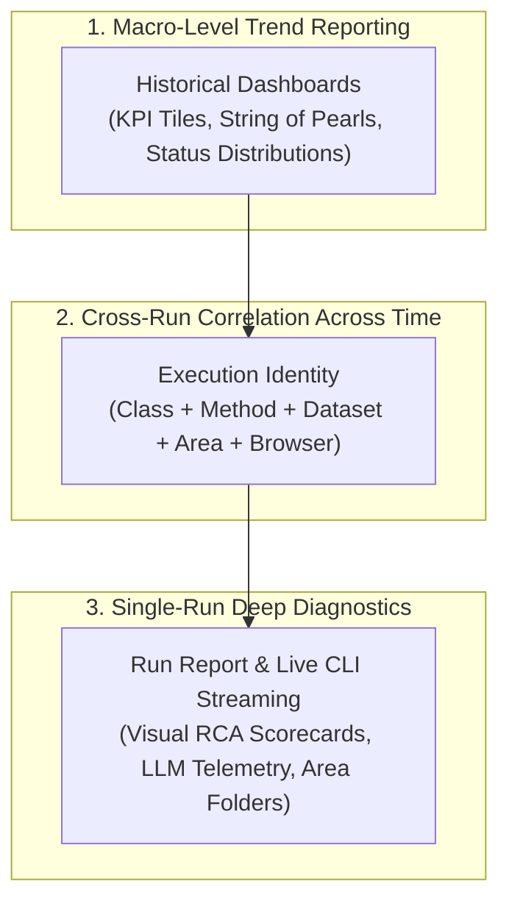
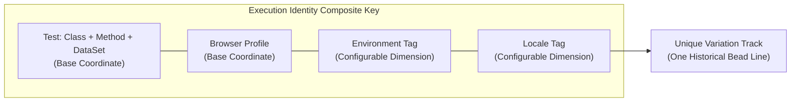

## 1. Accessing the AI Manager Dashboard

The Neodymium AI Manager serves as the centralized web hub for test suite telemetry, real-time execution monitoring, and historical quality analytics.

### Launching the Dashboard

Start the AI Manager application using the project launcher or Maven:

* **Linux / macOS:**
  ```bash
  ./run-neodymium.sh
  ```
* **Windows:**
  ```cmd
  run-neodymium.bat
  ```
* **Maven Direct:**
  ```bash
  mvn spring-boot:run -pl :neodymium-manager
  ```

Once initialized, navigate to `http://localhost:8080` in your web browser. The AI Manager opens directly into your primary dashboard:


### Key Dashboard Components

The primary dashboard provides immediate visibility into test suite health and resource consumption:

* **Executive KPI Tiles**: Key metrics showing overall pass rate, total test executions, active defect markers (`(bug)`), and average execution runtime.
* **Status Distribution Charts**: High-level pie, donut, and ratio charts categorizing test outcomes across `PASSED`, `HEALED`, `FAILED`, and `RUNNING` executions.
* **String of Pearls Timeline**: Beaded chronological timelines tracking test variation stability across consecutive batch runs and release cycles.
* **Recent Runs History**: A tabular view of recent test runs with execution IDs, status pills, durations, and direct links to inspect individual Run Reports.
* **Sidebar Navigation**: Switch between default dashboards (**General Overview**, **Test Health**, **Costs & Token Usage**), access custom or grouped dashboards, or navigate to **Runs History** (`/runs`) and **Test Base** (`/test-base`).

---

## 2. Observability Architecture

Neodymium AI connects individual test execution events with high-level historical analytics through three integrated layers:



---

## 3. Real-Time Run Reports (Live CLI & CI Streaming)

You do not need to trigger test runs from the AI Manager web interface to inspect live test progress. Tests launched from your local terminal or CI/CD runner can stream live execution telemetry directly into the AI Manager.

### Enabling Live Streaming

Ensure the AI Manager is running at `http://localhost:8080`, then pass the manager flags to your Maven command:

```bash
mvn test \
  -Dneodymium.managerActive=true \
  -Dneodymium.managerUrl=http://localhost:8080 \
  -Dneodymium.managerRunId="nightly-run-42"
```

Alternatively, configure the properties in `config/dev-neodymium.properties` for your local workstation:

```properties
# config/dev-neodymium.properties
neodymium.managerActive=true
neodymium.managerUrl=http://localhost:8080
```

### Live Streaming Mechanics

1. **Active Run Registration**: As soon as JUnit begins execution, `NeodymiumAiRunner` registers the run ID with the AI Manager.
2. **Push State Streaming**: During execution, the test runner pushes step state transitions, action descriptions, and base64 viewport screenshots via HTTP POST to `/api/console/internal/pushState`.
3. **Live Run Inspection**:
   * Open `http://localhost:8080/runs` to see active runs tagged with a dynamic **RUNNING** badge.
   * Drill into the **Run Report** to observe the live step progress bar, action timeline, and real-time screenshot stream.

:::tip[Interactive Failure Controls]
When running with `-Dneodymium.ai.interactive=true` alongside `-Dneodymium.managerActive=true`, failure pauses surface directly on the active Run Report. You can trigger on-demand AI healing or skip broken steps right from the browser. See [Neodymium AI Manager](/neodymium-ai/manager) for setup details.
:::

---

## 4. Test Tagging & Dimensional Grouping

Neodymium AI features an open, multi-dimensional tagging system. Tags allow you to categorize, filter, and organize test executions across all reporting surfaces, dashboards, and historical variation tracks.

You are not limited to fixed categories. You can attach arbitrary key-value metadata or simple label tags to any test.

### Declaring Tags

Tags can be declared in YAML playbooks, Java test classes, or injected dynamically at runtime.

#### In YAML Playbooks (Root and Dataset Levels)

Assign tags at the scenario level, or specialize them per dataset:

```yaml
# In your YAML playbook:
name: Order Checkout Flow
tags:
  Area: Checkout
  Suite: Regression
  Environment: Staging
  Owner: CheckoutTeam
  Feature: PaymentGateway
  Priority: High

datasets:
  - id: guest_checkout
    tags:
      Flow: Guest
  - id: registered_user
    tags:
      Flow: Registered
      Tier: VIP
```

#### In Java Test Classes (JUnit 5)

Annotate test classes or test methods using standard JUnit 5 `@Tag` annotations:

```java
// On your Java test class or method:
@Tag("Area:Checkout")
@Tag("Suite:Regression")
@Tag("Environment:Staging")
@Tag("Owner:CheckoutTeam")
@NeodymiumAiTest
public class CheckoutTest
{
    @Test
    @Tag("Priority:Critical")
    @Tag("Smoke")
    public void testCreditCardPurchase() { ... }
}
```

#### Runtime CLI Overrides

Inject or override tags dynamically during test execution without modifying files:

```bash
mvn test -Dneodymium.tag.Environment=Production -Dneodymium.tag.Branch=main
```

### Tag Precedence Hierarchy

When resolving the effective tags for a test execution, Neodymium applies a strict precedence order:

1. **CLI System Property Overrides** (`-Dneodymium.tag.<key>=<value>`) — Highest precedence.
2. **Dataset-Level Tags** (`datasets[].tags`) — Specializes tags for a specific data variation.
3. **Playbook Root-Level Tags** (`tags:`) — Default baseline tags for the entire scenario.

### Platform-Wide Tag Capabilities

Any declared tag is automatically available across the AI Manager:

* **Dashboard & Widget Filters**: Filter any widget, container card, or dashboard page by arbitrary tag keys and values (e.g. `Owner: CheckoutTeam`, `Environment: Staging`).
* **Group Dashboards**: Partition a dashboard dynamically by any tag dimension. Selecting `Environment` or `Owner` automatically generates dedicated sub-dashboard tabs for each discovered tag value.
* **Execution Identity Extension**: Promote any tag (such as `Environment`, `Device`, or `Branch`) into the test's Execution Identity to maintain independent historical variation lines.
* **Active Bug Scoping**: Bind expected defect tags (`(bug)`) to specific tag criteria so a known defect only marks runs as expected failures on target environments or configurations.

---

### Special Structural Tags: `Area` and `Suite`

While Neodymium treats all tags as queryable metadata, two tag dimensions—`Area` and `Suite`—play dedicated structural roles in report rendering and test batch organization:

#### The `Area` Dimension: Collapsible Report Accordions

The `Area` tag represents the primary functional application domain (e.g. `Area: Checkout`, `Area: Search`, `Area: Account`):

* **Run Report Accordions**: The AI Manager automatically groups test executions on the Run Report page into collapsible **Area Folders** (e.g. `📁 Area: Checkout` or `📁 Area: Search`).
* **Test Base Categorization**: The Test Base catalog organizes historical test variations under their corresponding Area sections.
* **Default Area Fallback**: Tests executed without an explicit `Area` tag are cleanly grouped under `📁 Area: Default`.
* **Area Ratio Visualizations**: Dedicated dashboard widgets calculate pass, fail, and healed rates per functional area to highlight domain-level regressions.

#### The `Suite` Dimension: Operational Execution Batches

The `Suite` tag specifies the operational batch or testing tier (e.g. `Suite: Smoke`, `Suite: Regression`, `Suite: Nightly`):

* **Runs List Partitioning**: The AI Manager catalogs and partitions test runs in the Runs History table under their declared `Suite` identifier.
* **Global Scope Filtering**: Dashboard pages and widgets provide one-click scope toggles for `Suite`, enabling teams to isolate metrics between nightly regression runs and rapid CI smoke checks.

---

## 5. Diagnostic Reporting & Visual RCA

When an assertion fails or an unexpected DOM condition halts progress, Neodymium AI performs a comprehensive post-mortem analysis surfaced directly within the Run Report.

### Visual Root Cause Analysis (Visual RCA) Card

The Run Report highlights a dedicated **Visual RCA** diagnostic block for failed test steps:

* **Root Cause Summary**: A natural-language explanation of why the action or assertion failed based on captured visual and DOM evidence.
* **4-Rubric Scorecard**:
  * **Target Presence**: `FOUND` (element visible $\rightarrow$ locator or timing defect) vs. `MISSING` (functional defect).
  * **Form Validation**: Identifies HTML5 validation tooltips (e.g. *"Please fill out this field"*) or error borders.
  * **Flow State**: Evaluates whether the test was genuinely `PROGRESSING` or became `STUCK`.
  * **Obstruction**: Identifies cookie banners, modal overlays, or loading spinners blocking interaction.

---

## 6. LLM Telemetry & Token Accounting

Every step execution records exact token metrics and model invocations. The Run Report displays an accounting table detailing prompt and completion consumption:

```text
LLM Calls & Tokens: 8 calls | 24,110 tokens (In: 22,500, Out: 1,610, Cached: 0)
  ├─ Action:            5 calls | 18,200 tokens
  ├─ Judge:             2 calls |  4,100 tokens
  ├─ Verification:      1 calls |  1,810 tokens
  └─ Visual RCA:        0 calls |      0 tokens
```

* **Inbound Tokens**: Prompt overhead, DOM snippets, and base64 screenshot image payloads.
* **Cached Tokens**: Context tokens reused by providers that support prompt caching.
* **Outbound Tokens**: Generated reasoning tokens and structured JSON tool-call invocations.
* **Call Breakdown**: Categorizes calls across execution phases (`Action`, `Judge`, `Verification`, and `Visual RCA`).

---

## 7. Execution Identity

When tests run repeatedly across automated test batches, reporting systems must determine: **"Which test execution in Run #2 corresponds to which test from Run #1?"**

Neodymium AI resolves this through **Execution Identity**—a composite coordinate key uniquely identifying a test variation across history.

### The Role of the Browser in Test Identity

In Neodymium, the browser profile is an essential coordinate of test identity rather than an arbitrary runtime tag. 

A browser profile defines more than just the browser family (`Chrome`, `Firefox`, `Safari`, `Edge`). It encapsulates:
* **Browser Engine & Version**: Gecko, Blink, or WebKit layout engines.
* **Viewport Geometry**: Exact window width and height (e.g. `1500x1000` desktop vs. `375x812` mobile emulation).
* **Execution Mode**: Headless vs. headed display states.

#### Why the Browser Dimension is Essential

1. **Responsive Breakpoints & DOM Layout**: Different viewports trigger distinct CSS media queries, causing menus to collapse, elements to reflow, or touch targets to change.
2. **Engine-Specific Rendering & Timing**: Layout engines handle CSS transforms, font metrics, and DOM event sequencing differently.
3. **Flakiness Isolation**: If a test passes on Chrome but fails on Firefox due to a browser-specific timing quirk, combining them into one identity would falsely classify the test as flaky. Isolating them by browser profile ensures stability on Chrome is tracked separately from Firefox.

---

### Identity Coordinates Structure



#### Base Coordinates

The base identity is permanently locked to:

* **Test**: Class Name + Method Name + DataSet ID (e.g. `CheckoutTest.testPurchase[us_credit]`).
* **Browser Profile**: Normalized browser configuration (e.g. `Chrome_1500x1000_headless`).

#### Configurable Identity Dimensions

Teams can customize the Execution Identity at the dashboard or widget level by including extra dimensions:

* `Environment` (e.g. `Staging` vs. `Production`)
* `Locale` (e.g. `en_US` vs. `de_DE`)
* Custom tags (e.g. `Device`, `Branch`)

#### Impact on Trend Analysis & String of Pearls

The selected Execution Identity coordinates directly define how historical trends render:

* **When `Environment` IS part of the Identity:**
  * `CheckoutTest (Chrome, Staging)` and `CheckoutTest (Chrome, Production)` render as **two separate historical bead lines** in the String of Pearls.
  * You can track staging stability independently of production deployments.
* **When `Environment` is NOT part of the Identity:**
  * Both executions contribute to a single historical track. The most recent run updates the overall variation state.

---

### Inspecting Test Identity in the Browser UI

The AI Manager surfaces test identity coordinates throughout the web interface to make multi-browser telemetry easy to inspect and manage:

#### 1. String of Pearls Timeline Tracks
Every horizontal bead line in the String of Pearls widget represents a distinct Execution Identity coordinate. Hovering over any bead displays a tooltip showing the exact test method, dataset, browser profile, execution status, and run duration.

#### 2. Composite Container Identity Badges
Container headers display an **Execution Identity Badge** (such as `[Test + Browser]` or `[Test + Browser + Environment]`). This badge informs viewers which coordinates are bound to the visualizations within that container card.

#### 3. Slide-out Test Side Panel
Clicking any bead, variation row, or test execution link in the browser opens the **Test Side Panel** drawer:
* Displays the complete coordinate breakdown (`Test Class`, `Method`, `Dataset`, `Browser Profile`, `Location`, and `Environment`).
* Lists the historical execution track for that specific browser variation across past test batches.
* Provides direct access to captured viewport screenshots and DOM state evidence recorded within that browser profile.
* Shows active bug associations (`(bug)`) bound specifically to that variation identity.

#### 4. Widget Configurator Dimension Controls
In the Widget Configurator modal, users can toggle Execution Identity dimensions on or off. You can override the dashboard's global identity for a specific widget to group or separate historical tracks.

:::important[Widget Combination Equivalence Rule]
To guarantee statistical accuracy, two dashboard widgets can only merge into a single container card if they share the **exact same Execution Identity dimensions** and evaluate the same contributing run scope. The browser UI enforces this rule during drag-and-drop actions.
:::

---

## 8. Comprehensive Dashboard Management

Neodymium AI Manager includes a modular dashboard engine for tracking test suite stability, flakiness trends, and token costs across time.

### Default Pre-Configured Dashboards

The AI Manager provides three pre-configured dashboards upon initial installation:

#### 1. General Overview Dashboard
Provides a holistic high-level snapshot of recent test executions, key performance indicators (KPIs), overall pass rate, token cost trajectory, and recent run history:


#### 2. Test Health Dashboard
Dedicated to flakiness tracking, healing frequency, step retry rates, and failure distributions across your test suites:


#### 3. Costs & Token Usage Dashboard
Detailed breakdown of LLM resource expenditure, tracking prompt tokens, cached input tokens, completion tokens, and dollar-equivalent costs per model:


---

### Dashboard Page Management

* **Custom Pages**: Create tailored dashboard views for specific teams, sprints, or release cycles.
* **Page Organization**: Rename, clone existing configurations, or delete obsolete dashboards.
* **Standard vs. Group Dashboards**:
  * **Standard Dashboards**: Curated collections of widgets with fixed filters.
  * **Group Dashboards**: Automatically partitions a dashboard by a selected dimension (e.g. by `Browser`, `Environment`, `Suite`, or `Area`). The Manager dynamically generates child sub-dashboard tabs for each discovered dimension value.


#### Configuring Group Dashboards

When creating or converting to a Group Dashboard, specify the grouping dimension to partition the test suite into overview cards and nested sub-dashboards:


Once configured, child dashboards appear neatly organized in the sidebar navigation tree:


The parent group page renders high-level summary cards with embedded status distribution charts for each group value:


---

### Widget Canvas & Layout

* **Flexible Sizing**: Place widgets in a responsive grid using 25% (quarter), 50% (half), 75% (three-quarter), or 100% (full-width) cards.
* **Drag-and-Drop Reordering**: Arrange widgets freely across the canvas.

#### Composite Containers (Widget Grouping)

You can combine two or more compatible widgets into a single **Composite Container Card** by dragging one widget directly onto another:

* **Drop Overlay**: Hovering a dragged widget over a target card displays *"Combine into Container"*.
* **Container Header**: Displays the container title, child widget count, target time scope, Execution Identity badge, and management controls (**Rename**, **Contributing Executions**, **Separate**, **Delete**).
* **Adaptive Child Layout**: Compact widgets (Pie, Donut, and Ratio charts) sit side-by-side, while wide visualizations (String of Pearls) automatically stretch across the full width.
* **Internal Reordering**: Each child section inside the container features its own drag handle for reordering charts within the container card.


#### Filtering in Widget Groups & Containers

Filtering operates across multiple coordinated tiers:

* **Static Run Scope Filters (Widget & Container Level)**:
  * By default, widgets evaluate runs scoped by global dashboard filters.
  * Any widget or container group can enable **"Custom Run Filters"** in the Widget Configurator to evaluate an independent dataset.
  * Configurable criteria include: Run Limit (last 5, 10, 25, 50, or All runs), Date/Timestamp range, Browsers, Locales, Environments, Areas, and custom tags (`Suite`, `Release`, `Branch`).
* **Interactive In-Container Cross-Filtering (Client-Side)**:
  * Containers embed a unified dataset of all evaluated test variations.
  * Clicking any slice in a child widget (e.g. the Failed slice in a Status Pie Chart) triggers client-side cross-filtering across sibling charts without reloading.
  * Sibling ratio bars or cost metrics adjust immediately to reflect the filtered slice, while unmatched rows or timeline beads dim or hide.
* **Filtered Contributing Executions Modal**:
  * Clicking the list icon on a container opens the executions modal scoped to active filters, with real-time text searching and status toggles (`Passed`, `Fixed`, `Flaky`, `Failed`, `Ignored`).


#### Widget Configurator & Presentation Formats

Each widget can be customized with specific execution identity overrides, scope filters, and presentation formats (Pie, Donut, Ratio Bar, Beaded Timeline, or Tabular List):


---

### Widget Catalog

* **Status Distribution**: Pie, donut, and ratio bar charts breaking down test outcomes (`PASSED`, `HEALED`, `FAILED`, `RUNNING`).


* **String of Pearls**: Chronological beaded timelines displaying the status progression of individual test variations across recent batch runs or release cycles.


* **Known Variation Tracks**: Tracks recognized test execution variations across historical runs according to the configured Execution Identity:


* **Flakiness & Defect Tracking**: Identifies unstable test steps, frequently healed selectors, and expected bug tag (`(bug)`) trends:


* **Token Cost & Usage Trends**: Chronological bar and line graphs tracking cumulative prompt, completion, and cached token consumption over time to monitor cloud LLM costs.
* **List of Runs**: Full tabular history of recent test runs with execution IDs, status pills, durations, and direct links to reports.
* **Metric Summary Cards**: High-level KPI tiles for pass rate, total runs, active defects, and average runtime.

---

## 9. Report Storage & Persistence

The Neodymium AI Manager supports flexible persistence options:

* **Local File System**: Default storage using clean JSON execution logs under your workspace.
* **Relational Database**: Embedded SQLite or H2 database support for local workstation and CI server setups.
