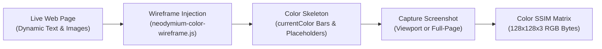

Modern web applications present visual challenges that traditional Document Object Model (DOM) test frameworks cannot solve:
* Dynamic text, rotating banners, and timestamps that break traditional pixel-diff tools.
* Textless icon buttons and obfuscated CSS-in-JS classes (`.css-1a2b3c`, `.rt8oam`) lacking stable DOM selectors.
* Headless `<canvas>`, WebGL, and SVG elements that render graphics directly with zero interactive child DOM nodes.

Neodymium AI introduces a multimodal visual testing suite that handles these challenges cleanly and deterministically.

---

## 1. Pixel-Exact Visual Verification (`(visual)`)

For design systems, brand guidelines, and static components where pixel-level fidelity is required, append `(visual)` to your verification step:

```yaml
steps: |
  Open ${app.url}/styleguide in the browser
  Verify the brand logo and header alignment (visual)
  Verify the full landing page from header to footer (visual: full)
```

### How It Works
1. **Viewport vs. Full Page**:
   - `(visual)`: Captures the visible browser viewport at the active screen resolution.
   - `(visual: full)`: Scrolls the full page height and captures a stitched composite screenshot.
2. **$128 \times 128$ Luminance SSIM Matrix**: Neodymium AI downsamples the captured screenshot to a $128 \times 128$ luminance matrix, serialized as a compact baseline hash in the companion `.recording.json` file.
3. **Deterministic Replay ($< 10\text{ ms}$)**: On subsequent replay runs, the browser compares the live screenshot's SSIM matrix against the baseline across local $8 \times 8$ blocks with **0 LLM calls**.
4. **Threshold Overrides**: Override default tolerance (`0.99`) per step:
   ```yaml
   Verify status card styling (visual: min-score=0.98)
   ```

---

## 2. Content-Agnostic Fuzzy Layout Testing (`(layout)`)

Traditional visual regression tools compare raw image pixels (`toMatchSnapshot()`). While useful for static designs, pixel-diffing continuously fails in real web applications because:
* Promotional headlines and marketing text change frequently.
* Dynamic user data (cart counts, dates, prices) fluctuates.
* Product image assets vary across environments.

Such changes cause pixel-diff tests to fail continually, even though the page layout, component grid, brand styling, and alignments remain 100% correct.

### The Color Wireframing Solution
When a step is tagged with `(layout)` or `(layout: full)`, Neodymium AI injects a client-side color wireframe engine (`neodymium-color-wireframe.js`) immediately prior to screenshot capture:



1. **Text Redaction via `currentColor`**: All typography (`p`, `span`, `h1`-`h6`, `a`, `button`) is converted into solid skeleton bars matching their exact rendered width and height while **preserving the computed CSS brand color** of the element (e.g., navy headers, dark neutral body copy). Changing text content preserves the structural block width and color without triggering a false visual defect.
2. **Media Neutralization**: All images (`img`, `picture`, `canvas`, `video`) are replaced with uniform neutral placeholder boxes while preserving their dimensions and grid footprints.
3. **3-Channel Color SSIM Matrix ($128 \times 128 \times 3$)**: Evaluates both spatial structure (margins, card dimensions, flexbox wrapping) and brand color palette (card fills, hero tints).
4. **Tolerance Threshold**: Uses a default structural acceptance threshold of `0.92` (compared to `0.99` for pixel-exact checks):
   ```yaml
   steps: |
     Open ${app.url}/catalog in the browser
     Verify product catalog grid layout (layout)
     Verify entire checkout flow structure (layout: full, min-score=0.90)
   ```

---

## 3. Set-of-Marks (SoM) Visual Markers (`(marker)`)

Modern web applications often feature elements that exist in the DOM but lack stable, human-readable locators—such as textless icon buttons (shopping carts, hamburger menus, notification bells, carets):

Append `(marker)` to any interaction step to activate the Set-of-Marks visual grounding engine:

```yaml
steps: |
  Open ${app.url}/dashboard in the browser
  Click the shopping cart icon (marker)
  Click the user avatar profile button (marker)
```

### Execution Lifecycle
1. **Numbered Badge Overlay**: Neodymium AI superimposes high-contrast, numbered visual badges (`[1..N]`) over interactive elements currently in the viewport.
2. **Visual Multimodal Grounding**: The LLM inspects the marked screenshot and targets the intended element by its badge number (`marker:3`).
3. **Anchor Normalization**: The engine normalizes child SVG paths up to the parent interactive button and calculates a stable container-relative coordinate (`coord:<selector>@relX,relY`).
4. **Clean Baseline Capture**: Marker overlays are cleared from the DOM, and a clean pre-click baseline is saved.
5. **Zero-Token Replay**: Subsequent runs click the spatial anchor coordinates directly via native Selenium `Actions` with **0 tokens spent**.

---

## 4. Canvas, WebGL & SVG Coordinate Grounding

For interactive HTML5 `<canvas>`, WebGL graphs (Chart.js, D3), mapping engines, and signature pads with zero child DOM nodes:

```yaml
steps: |
  Open ${app.url}/charts in the browser
  Click the blue confirm button in the canvas chart
```

* Neodymium AI's multimodal vision model pinpoints the visual target centroid $(x, y)$.
* **Auto-Pinning**: The absolute coordinate is automatically transformed into a relative offset from the enclosing container (e.g. `coord: #canvas-stage@300,75`).
* Replay executes via native hardware mouse events (`Actions.moveToElement(container, dx, dy).click()`).

---

## 5. Visual Root Cause Analysis (Visual RCA)

When an automated test step fails during execution (e.g. an element timeout or missing text assertion), Neodymium AI does not stop at generic framework exceptions like `TimeoutException: Element not found within 4000ms`.

Instead, the engine captures the final browser screenshot and triggers **Visual Root Cause Analysis (Visual RCA)**, evaluating the failure against four mandatory diagnostic rubrics:

| Diagnostic Rubric | Assessment Criteria | Status Outputs |
| :--- | :--- | :--- |
| **`targetPresence`** | Objectively checks if the expected text, button, or message is visibly rendered on screen (identifying selector timeouts vs. real defects). | `FOUND` \| `MISSING` |
| **`formValidation`** | Scrutinizes visible inputs for browser HTML5 validation bubbles (`! Please fill out this field`) or red error outlines. | `ERROR_PRESENT` \| `CLEAN` |
| **`flowState`** | Correlates active URL and visible screen with previous actions to determine if the page transitioned or remained stuck. | `STUCK` \| `PROGRESSING` |
| **`obstruction`** | Detects modal dialog overlays, cookie consent banners, loading spinners, or disabled buttons blocking interaction. | `OBSTRUCTED` \| `CLEAR` |

The synthesized diagnostic root cause and scorecard are rendered prominently in both HTML and Markdown execution reports, providing instant answers for failed test runs.
